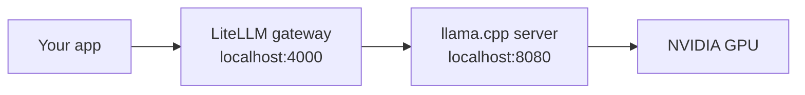

# litellm-llamacpp-setup

Run models on your NVIDIA GPU and call them all through one OpenAI-compatible API.



| Service | Address | Role |
|---|---|---|
| [llama.cpp](https://github.com/ggml-org/llama.cpp) | `http://localhost:8080` | Runs the models on the GPU |
| [LiteLLM](https://docs.litellm.ai) | `http://localhost:4000` | Gateway and API. Admin UI at `/ui` |

## Requirements

- [Docker](https://docs.docker.com/get-docker/) with [Docker Compose](https://docs.docker.com/compose/)
- NVIDIA GPU with the [NVIDIA Container Toolkit](https://docs.nvidia.com/datacenter/cloud-native/container-toolkit/latest/install-guide.html)
- Internet access, so llama.cpp can download models from [Hugging Face](https://huggingface.co)

## Quick start

1. Create your config files from the examples.

   ```bash
   cp litellm/.env.example litellm/.env
   cp llama-cpp/.env.example llama-cpp/.env
   cp llama-cpp/presets.ini.example llama-cpp/presets.ini
   cp litellm/provider/llamacpp.ini.example litellm/provider/llamacpp.ini
   ```

2. Set your secrets.

   | File | Set |
   |---|---|
   | `litellm/.env` | `POSTGRES_PASSWORD`, `LITELLM_ADMIN_PASSWORD` |
   | `llama-cpp/.env` | `LLAMA_CPP_API_KEY` |

3. Add a model to `llama-cpp/presets.ini`. Uncomment one example block and set its `hf-repo`. See [Models](docs/models.md).

4. Point the gateway at your llama.cpp server in `litellm/provider/llamacpp.ini`. See [Providers](docs/providers.md).

   > [!IMPORTANT]
   > Use the server's LAN hostname or IP, not `localhost`. The gateway runs in Docker, so `localhost` means the gateway container itself.

5. Start both services.

   ```bash
   docker compose -f llama-cpp/docker-compose.yaml up -d
   docker compose -f litellm/docker-compose.yaml up -d
   ```

6. Open `http://localhost:4000/ui/`. Your models should be listed.

## Call the API

```bash
curl http://localhost:4000/v1/chat/completions \
  -H "Authorization: Bearer <LITELLM_ADMIN_PASSWORD>" \
  -H "Content-Type: application/json" \
  -d '{"model":"<model-name>","messages":[{"role":"user","content":"hi"}]}'
```

- Replace `<LITELLM_ADMIN_PASSWORD>` with the value in `litellm/.env`. This password is also the API key for your clients.
- Replace `<model-name>` with the name shown in the Admin UI.

## Update llama.cpp

```bash
cd llama-cpp
./update.sh                      # pulls the newest llama.cpp image
docker compose up -d             # restarts with the new image
```

## Private files

These files hold your secrets and settings. Git ignores them.

| Path | Holds |
|---|---|
| `litellm/.env` | Database and admin passwords |
| `llama-cpp/.env` | llama.cpp API key |
| `llama-cpp/presets.ini` | Your model list and settings |
| `litellm/provider/llamacpp.ini` | Your server addresses and keys |
| `llama-cpp/models/` | Downloaded model weights |
| `litellm/config.yaml` | Generated at every gateway start |

## More

| Topic | Page |
|---|---|
| Models and presets | [docs/models.md](docs/models.md) |
| Providers and sync | [docs/providers.md](docs/providers.md) |
